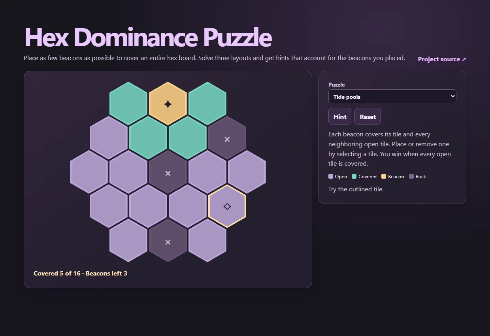

# Hex Dominance Puzzle

Place as few beacons as possible to cover an entire hex board. Solve three layouts and get hints that account for the beacons you placed.

[Open the browser app](https://surfingcoder.com/apps/hex-dominance-puzzle/)

## Run locally

Run the following command in this repository and open [localhost:8000](http://localhost:8000).

    python -m http.server 8000

Open any of the three boards. The beacon limit is the smallest possible number for that board. Hint identifies a compatible next beacon, or asks you to revise the current placement. Tiles are reachable through normal keyboard tab navigation.

## Verify

Run the following command with Node.js 22 or newer.

    node --test
